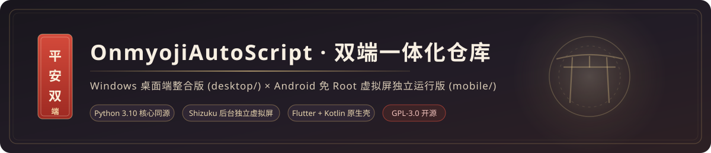
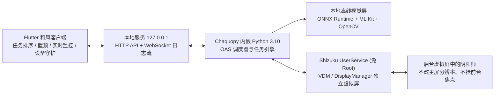

> 一个把 **电脑端整合版（`desktop/`）** 与 **手机免 Root 后台独立运行版（`mobile/`）** 收录在同一仓库里的个人长期自用与维护工程。  
> 核心目标很简单：**电脑上能稳定托管，手机上也能不连电脑、不 Root、不抢主屏，在后台独立把日常与周常跑完。**

- **手机端成品 APK 下载**：前往 [Releases · v0.3.4-b78](https://github.com/Jacklove331-source/OnmyojiAutoScript-All/releases/tag/v0.3.4-b78)（含 `arm64-v8a` 安装包、`oas-patch.zip` 热更包与 `SHA-256` 校验文件，安装后默认直连本仓库在线更新）
- **开源协议**：[GNU General Public License v3.0](LICENSE)

---

## 一、双端总览

| 维度 | 电脑端 `desktop/` | 手机端 `mobile/` |
|---|---|---|
| **运行形态** | Windows 桌面端 + 安卓模拟器（MuMu 等） | 纯安卓手机本地独立运行，无需电脑与模拟器 |
| **核心引擎** | Python 3.10 + ONNX OCR + 60+ 任务模块 | 通过 Chaquopy 内嵌同一套 Python 3.10 引擎 |
| **前端界面** | 桌面 GUI / Web 服务 | Flutter 和风界面 + Kotlin 原生守护与桥接 |
| **屏幕与控制** | ADB / nemu_ipc / 模拟器截图控制 | Shizuku 独立后台虚拟屏（Android 14~16 VDM / DisplayManager） |
| **多端互通** | 导出配置 `.json` | 直接兼容同一套任务体系与 `.json` 配置结构 |
| **实测状态** | 长期主力挂机分支 | 已在 Android 16 (OriginOS 6) 真机完成 24 任务全链路清零实测 |

---

## 二、手机端架构原理

手机端并不是远程遥控壳，而是把整套 OAS 引擎装进了 APK 本地运行，并借由 Shizuku 把游戏投放到一块独立的后台虚拟屏上，前台刷视频、回消息与后台挂机互不干扰：



---

## 三、本仓库的自改与真机打磨记录

在继承上游 OAS / OASX 的基础上，本仓库重点面向**真实日常长期挂机**做了大量工程化改造与真机踩坑修复：

### 1. 手机端专属功能与交互
- **和风视觉定制**：全面替换界面图标为和风/阴阳师风格视觉，对齐桌面端官方中文译名（1500+ 词条）。
- **首页纯任务队列视图**：直观呈现「运行中 / 待执行 / 等待中」排期顺序，支持任意任务一键置顶优先执行与一键展开全部队列。
- **实时监控与手动接管**：内置监控页可实时预览后台虚拟屏画面与运行日志，随时暂停、点按介入或将游戏切回主屏。
- **硬件与电源安全守护**：接入 Android 原生电池温度、电量百分比、充电与 Wi-Fi 状态监测，支持异常自动停机保护。
- **内置 GitHub 在线更新（数据包热更 + APK 自更新）**：默认直接对接本公开库，免填令牌即可在 App 内「我的 → 在线更新」一键拉取最新 Python 脚本热更或下载新版 APK，同时支持在弹窗里切换自定义仓库或 GitCode 源。

### 2. 真机全流程实测与稳定性修复
以下问题均在真机连续调度实测中发现、定位修复并补充了主机侧单元测试：
- **开屏与选角识别**：适配新版开屏底图变化，加入 OCR 标题页兜底进入选角器及短角色名视觉校验，选角后首帧立即推进。
- **后台墓碑冻结自愈**：针对安卓系统切后台短暂冻结进程后恢复瞬间触发截屏超时（`no fresh frame`）的问题，自动识别冻结恢复、重置截屏与卡死计时并补抓最新帧。
- **移动端 OCR 纠偏**：兼容手机端 PP-OCR 常见形近字与红底艺术字截断（如结界卡「勾玉 → 幻玉」、组队年兽单字标题「年」、悬赏繁体「數量/採索」等）。
- **防死循环与弹窗脱困**：给庭院收邮件增加超时与单次防重入；修复集体任务今日 30/30 上限退出未关红叉弹窗导致神社页连环卡死，并为神社退出增加「先关红叉再返回」双保险；补齐「式神图鉴、神秘商店、契灵之境」等游戏内页到登录守卫特征词。
- **安卓安全适配**：手机端每周琐事自动跳过外部微信分享（避免拉起手机微信或在改版图鉴页卡死），保留本地摸鱼存次数与抽破碎符咒。

---

## 四、使用与构建指南

<details open>
<summary><b>方式 A：手机端直接安装使用（推荐）</b></summary>

1. 准备一部 Android 11+ 的 64 位手机，安装并激活 [Shizuku](https://shizuku.rikka.app/)（系统无线调试即可启动，无需 Root）。
2. 前往 [Releases](https://github.com/Jacklove331-source/OnmyojiAutoScript-All/releases) 下载 `OASX-Mobile-*-arm64-v8a.apk` 并安装。
3. 打开 **OASX**，授予 Shizuku 与通知权限。
4. **强烈建议**：前往手机 **设置 → 电池 → 后台耗电管理**，将 **OASX** 与 **阴阳师** 设置为「允许后台高耗电 / 无限制」，避免锁屏或切后台时被系统冻结。
5. 在「脚本」页勾选需要的日常/周常任务并填好角色设置，回到「首页」启动调度即可；随时可在「监控」页查看后台虚拟屏画面与日志。

</details>

<details>
<summary><b>方式 B：电脑端部署运行（desktop/）</b></summary>

```bash
git clone https://github.com/Jacklove331-source/OnmyojiAutoScript-All.git
cd OnmyojiAutoScript-All/desktop
pip install -r requirements.txt
python gui.py
```

- 如需仅运行后台调度服务，可执行 `python server.py`。
- 仓库仅保留干净配置模板 `desktop/config/template.json`，首次运行后请在界面中新建个人配置。

</details>

<details>
<summary><b>方式 C：从源码编译手机端与运行测试（mobile/）</b></summary>

- **构建依赖**：Flutter SDK、JDK 17、Android SDK（`compileSdk 36` / `targetSdk 36`）、Python 3.10（可通过环境变量 `OAS_BUILD_PYTHON` 指定解释器路径，默认使用系统 `python`）。

```powershell
cd mobile
flutter pub get
$env:ORG_GRADLE_PROJECT_abi = "arm64-v8a"
flutter build apk --release --no-tree-shake-icons --target-platform android-arm64
```

运行主机侧自动化回归测试（无需连接手机）：

```powershell
python test/host/test_android_contract.py android/app/src/main/python
python test/host/test_navigation_recovery.py android/app/src/main/python
python test/host/test_mobile_login.py android/app/src/main/python
python test/host/test_restart_login.py android/app/src/main/python
flutter test
```

</details>

---

## 五、开源借鉴与出处致谢

本项目站在大量优秀开源项目的肩膀上完成，开发过程中直接继承、依赖或借鉴设计思路的开源项目均列明出处如下（按架构层次分类，谨向各位原作者致谢）：

### 1. 核心脚本引擎、分支扩展与客户端框架
| 项目 | 仓库地址 | 借鉴与使用说明 |
|---|---|---|
| **OnmyojiAutoScript (OAS)** | https://github.com/runhey/OnmyojiAutoScript | 电脑端与手机端共同的 Python 自动化核心引擎、页面图谱、资产体系与任务调度直接上游 |
| **OASX** | https://github.com/runhey/OASX | 手机端 Flutter 客户端框架、API / WebSocket 通信协议与中文译名体系的直接基础 |
| **OnmyojiAutoScript (xylolit 分支)** | https://github.com/xylolit-mu/OnmyojiAutoScript | 桌面端整合分支中部分扩展任务（如百鬼棋局等）与功能适配参考来源 |
| **AzurLaneAutoScript (ALAS)** | https://github.com/LmeSzinc/AzurLaneAutoScript | 整个脚本体系的视觉匹配、设备抽象与状态机设计原始渊源 |
| **StarRailCopilot (SRC)** | https://github.com/LmeSzinc/StarRailCopilot | 模块化配置与新一代架构思路参考（经由上游 OAS 继承） |

### 2. 安卓免 Root 后台虚拟屏与原生控制参考
| 项目 | 仓库地址 | 借鉴与使用说明 |
|---|---|---|
| **Shizuku** | https://github.com/RikkaApps/Shizuku | 手机端免 Root 获取 shell 权限与 `UserService` Binder 通道的核心依赖 |
| **MAA / MAA-Meow** | https://github.com/MaaAssistantArknights/MaaAssistantArknights | 借鉴其 Android 14+ `VirtualDeviceManager` 后台虚拟屏控制思路（对应 `VdmDisplay.java`） |
| **headless-android** | https://github.com/HakaI963/headless-android | 借鉴无头虚拟显示创建与后台投放应用的思路（对应 `HiddenDisplay.kt`） |
| **vdisplay-android** | https://github.com/MerlinShieh/vdisplay-android | 借鉴隐藏虚拟屏配合 `am start --display` 启动目标游戏的实现思路（对应 `HiddenDisplay.kt`） |
| **ALAS-AOS** | https://github.com/Dreamry2C/ALAS-AOS | 开发初期调研安卓端后台虚拟屏托管脚本链路的重要参考项目 |
| **XYZ** | https://github.com/Xiao-yu-ze/XYZ | 调研 Shizuku 虚拟屏与后台输入注入可行性的早期参考实现 |

### 3. 运行时底座、OCR 识别与算法组件
| 项目 / 组件 | 项目地址 | 借鉴与使用说明 |
|---|---|---|
| **Chaquopy** | https://github.com/chaquo/chaquopy | 将 CPython 3.10 及科学计算依赖直接内嵌打包进 Android APK |
| **PaddleOCR (PP-OCRv6_small)** | https://github.com/PaddlePaddle/PaddleOCR | 桌面端与移动端离线中文文字识别模型来源 |
| **ppocr-onnx** | https://github.com/triwinds/ppocr-onnx | 基于 ONNX Runtime 的轻量级 PP-OCR 推理封装 |
| **ONNX Runtime / Android** | https://github.com/microsoft/onnxruntime | 电脑端与手机端本地神经网络推理运行时（MIT） |
| **Google ML Kit (Chinese OCR)** | https://developers.google.com/ml-kit | 手机端离线中文识别补充通道 |
| **oashya (runhey)** | `oashya 0.0.7` (MIT) | 百鬼夜行检测模型与标签辅助定义（详见 `mobile/docs/ANDROID_THIRD_PARTY.md`） |
| **gurs** | https://github.com/2833844911/gurs | 贝塞尔曲线拟人化滑动轨迹算法（由上游 OAS 引入） |
| **Flutter & FluentUI** | https://github.com/flutter/flutter · https://github.com/zhuzichu520/FluentUI | 手机端跨平台 UI 框架与桌面端界面组件依赖 |
| **Pydantic / OpenCV / FastAPI / uiautomator2** | 各自官方开源仓库 | 配置模型校验、图像处理、本地服务通信与桌面端 ADB 控制基础库 |

---

## 六、开源声明与免责说明

- 本仓库代码遵循 **GPL-3.0** 协议完全免费开源，仅用于技术研究、自动化测试与个人学习交流。
- 严禁将本项目用于任何商业售卖行为；若你在任意第三方渠道付费购买了本软件，请立即申请退款。
- 使用自动化工具可能存在一定账号风险，请使用者自行评估并承担相应后果。
