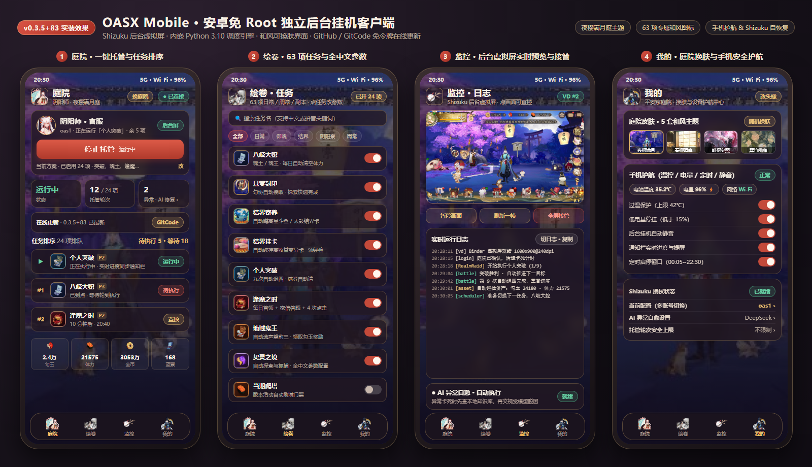
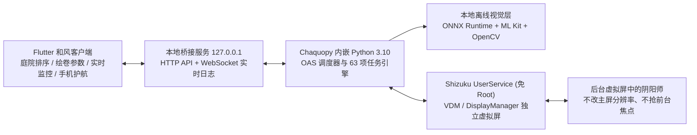

> **🔴 目前功能和UI 初期逐步优化中 不是很完善 —— 有兴趣的可以自己去修改**

---


> 一个专为 **Android 手机本地独立运行** 打造的阴阳师自动化托管工程（`mobile/`）。  
> 核心目标很简单：**不连电脑、无需 Root、不抢手机主屏，在后台独立虚拟屏里把日常与周常稳稳跑完。**

- **最新版手机端 APK 下载（`v0.3.5-b83`）**：
  - **GitHub Releases**：[前往下载 v0.3.5-b83](https://github.com/Jacklove331-source/OnmyojiAutoScript-All/releases/tag/v0.3.5-b83)（含真机 `arm64-v8a` 与 `x86_64` 双架构安装包）
  - **GitCode 国内极速镜像**：[前往下载 v0.3.5-b83](https://gitcode.com/wrsndm1/oas-private/releases/tag/v0.3.5-b83)
  - App 内首页「在线更新」支持一键切换 **GitHub / GitCode（国内公开源）**，均**无需令牌**，支持自动检测更新、Python 脚本热更新与 APK 一键自更新。
- **开源协议**：[GNU General Public License v3.0](LICENSE)

---

## 一、实装界面效果图

### 1. 四大核心页面总览（夜樱满月庭主题 · v0.3.5+83）



### 2. 真机实拍与 63 项和风 Q 版任务图标

<table>
  <tr>
    <td width="30%" align="center">
      <b>Android 16 真机实拍（夜樱满月庭）</b><br/><br/>
      
    </td>
    <td width="70%" align="center">
      <b>63 项专属和风 Q 版任务图标全览</b><br/><br/>
      
    </td>
  </tr>
</table>

---

## 二、手机端架构原理

OASX Mobile 并不是远程控制壳，而是通过 Chaquopy 把完整 Python 3.10 任务引擎与离线 OCR 直接打包进 APK 本地运行，并借由 Shizuku 将游戏投放到独立后台虚拟屏上。前台刷视频、回消息与后台挂机互不干扰：



---

## 三、核心特性与真机打磨记录

### 1. 手机端专属功能与和风交互
- **和风视觉与多套庭院换肤**：内置 5 套庭院主题皮肤（夜樱满月庭 / 春樱晴庭 / 绯樱夕照 / 翠竹幽庭 / 平安居室）、式神头像自定义与 63 项专属不重复任务图标，所有任务名、参数分组与皮肤枚举均已全面汉化（1500+ 中文词条）。
- **庭院任务队列与一键操控**：直观展示「运行中 / 待执行 / 等待中」排期顺序，支持任意任务一键置顶或立即开跑、一键展开全部排队列表，并内置庭院资产只读快照（勾玉 / 体力 / 金币 / 蓝票）。
- **Shizuku 断连原地等待与自动恢复**：Shizuku 未启动或中途断开时不会把任务推迟 30 分钟，也不会终止调度器；首页弹出醒目提示并提供一键跳转，手动启动 Shizuku 后 1.5 秒内自动拉起虚拟屏与游戏。
- **实时监控与全屏手动接管**：内置监控页实时预览后台虚拟屏画面与日志，随时暂停、直接点按操作、全屏接管或一键把游戏切回主屏。
- **手机安全护航**：原生监测电池温度、电量、充电与网络状态，支持过温保护、低电停挂、后台自动静音、定时启停窗口与通知栏实时进度；触发保护时在首页清晰提示原因并提供一键恢复。
- **首页自动检测与双源在线更新**：冷启动自动检测更新，内置 **GitHub / GitCode（国内）** 双公开源，无需令牌即可完成数据包热更与 APK 自更新；覆盖安装新 APK 时自动停用旧热更缓存，保证新代码即时生效。

### 2. 真机长跑稳定性打磨
以下问题均在 Android 16 (OriginOS 6) 真机连续 24 任务全链路清零实测中定位修复并补齐自动化回归测试：
- **开屏与选角识别**：适配新版开屏底图变化，加入 OCR 标题页兜底进入选角器与短角色名校验。
- **后台冻结自愈**：针对安卓系统切后台短暂冻结后恢复瞬间截屏超时的问题，自动识别冻结恢复、重置计时并补抓新帧。
- **移动端 OCR 纠偏**：针对手机端 PP-OCR 常见形近字与红底艺术字截断（如结界卡、组队年兽、悬赏繁体字）做精准兼容。
- **防死循环与弹窗脱困**：修复庭院收邮件、集体任务 30/30 上限红叉弹窗与神社返回链路，支持接入 DeepSeek 视觉自愈兜底。
- **安卓专属安全适配**：每周琐事自动跳过拉起外部微信的分享步骤，保留本地存次数与抽破碎符咒。

---

## 四、安装使用与源码构建

<details open>
<summary><b>方式 A：直接安装手机端 APK（推荐）</b></summary>

1. 准备一部 Android 11+ 的 64 位安卓手机，安装并激活 [Shizuku](https://shizuku.rikka.app/)（系统无线调试即可启动，无需 Root）。
2. 前往 [GitHub Releases](https://github.com/Jacklove331-source/OnmyojiAutoScript-All/releases) 或 [GitCode Releases](https://gitcode.com/wrsndm1/oas-private/releases) 下载 `OASX-Mobile-*-arm64-v8a.apk` 并安装。
3. 打开 **OASX Mobile**，授予 Shizuku 与通知权限。
4. **强烈建议**：前往手机 **设置 → 电池 → 后台耗电管理**，将 **OASX Mobile** 与 **阴阳师** 设为「允许后台高耗电 / 无限制」，避免锁屏或切后台时被系统冻结。
5. 在「绘卷」页勾选需要的日常/周常任务并配好角色参数，回到「庭院」点一下 **开始托管** 即可；随时可在「监控」页查看后台虚拟屏画面与实时日志。

</details>

<details>
<summary><b>方式 B：从源码编译 APK 与运行测试（mobile/）</b></summary>

- **构建环境**：Flutter SDK、JDK 17、Android SDK（`compileSdk 36` / `targetSdk 36`）、Python 3.10（可通过环境变量 `OAS_BUILD_PYTHON` 指定解释器路径）。

```powershell
cd mobile
flutter pub get
flutter build apk --release --no-tree-shake-icons --target-platform android-arm64
```

运行主机侧自动化回归测试（无需连接手机）：

```powershell
python test/host/test_runtime.py android/app/src/main/python
python test/host/test_android_contract.py android/app/src/main/python
python test/host/test_assets_and_ota.py
python test/host/test_ai_recovery_history.py
python test/host/test_task_end_failure.py
flutter test
```

</details>

---

## 五、开源借鉴与出处致谢

本项目站在众多优秀开源项目的肩膀上完成，开发过程中直接继承、依赖或借鉴设计思路的项目均列明出处如下，谨向各位原作者致谢：

### 1. 脚本引擎与客户端框架
| 项目 | 仓库地址 | 使用与借鉴说明 |
|---|---|---|
| **OnmyojiAutoScript (OAS)** | https://github.com/runhey/OnmyojiAutoScript | 核心 Python 自动化任务引擎、页面图谱、资产与调度体系上游 |
| **OASX** | https://github.com/runhey/OASX | Flutter 客户端框架、API / WebSocket 协议与中文词条体系基础 |
| **AzurLaneAutoScript (ALAS)** | https://github.com/LmeSzinc/AzurLaneAutoScript | 视觉匹配、设备抽象与状态机设计原始渊源 |
| **StarRailCopilot (SRC)** | https://github.com/LmeSzinc/StarRailCopilot | 模块化配置与任务架构思路参考（经由上游 OAS 继承） |

### 2. 安卓免 Root 后台虚拟屏与原生控制
| 项目 | 仓库地址 | 使用与借鉴说明 |
|---|---|---|
| **Shizuku** | https://github.com/RikkaApps/Shizuku | 免 Root 获取 shell 权限与 `UserService` Binder 通道的核心依赖 |
| **MAA / MAA-Meow** | https://github.com/MaaAssistantArknights/MaaAssistantArknights | 借鉴 Android 14+ `VirtualDeviceManager` 后台虚拟屏与 Binder 帧流思路 |
| **headless-android** | https://github.com/HakaI963/headless-android | 借鉴无头虚拟显示创建与后台投放应用思路 |
| **vdisplay-android** | https://github.com/MerlinShieh/vdisplay-android | 借鉴隐藏虚拟屏与 `am start --display` 启动目标游戏思路 |
| **ALAS-AOS** | https://github.com/Dreamry2C/ALAS-AOS | 安卓端后台虚拟屏托管脚本链路前期参考项目 |
| **XYZ** | https://github.com/Xiao-yu-ze/XYZ | Shizuku 虚拟屏与后台输入注入可行性早期参考实现 |

### 3. 嵌入式运行时、OCR 与算法组件
| 项目 / 组件 | 项目地址 | 使用与借鉴说明 |
|---|---|---|
| **Chaquopy** | https://github.com/chaquo/chaquopy | 将 CPython 3.10 与科学计算依赖内嵌打包进 Android APK |
| **PaddleOCR (PP-OCRv6_small)** | https://github.com/PaddlePaddle/PaddleOCR | 移动端离线中文文字识别模型来源 |
| **ppocr-onnx** | https://github.com/triwinds/ppocr-onnx | 基于 ONNX Runtime 的轻量级 PP-OCR 推理封装 |
| **ONNX Runtime Android** | https://github.com/microsoft/onnxruntime | 手机端本地神经网络推理运行时（MIT） |
| **Google ML Kit (Chinese OCR)** | https://developers.google.com/ml-kit | 手机端离线中文识别补充通道 |
| **oashya (runhey)** | `oashya 0.0.7` (MIT) | 百鬼夜行检测模型与标签定义（详见 `mobile/docs/ANDROID_THIRD_PARTY.md`） |
| **gurs** | https://github.com/2833844911/gurs | 贝塞尔曲线拟人化滑动轨迹算法（由上游 OAS 引入） |
| **Flutter / OpenCV / Pydantic** | 各自官方开源仓库 | 移动端 UI 框架、图像处理与配置模型校验基础库 |

---

## 六、开源声明与免责说明

- 本仓库代码遵循 **GPL-3.0** 协议完全免费开源，仅用于技术研究、自动化测试与个人学习交流。
- 严禁将本项目用于任何商业售卖行为；若你在任意第三方渠道付费购买了本软件，请立即申请退款。
- 使用自动化工具可能存在一定账号风险，请使用者自行评估并承担相应后果。
