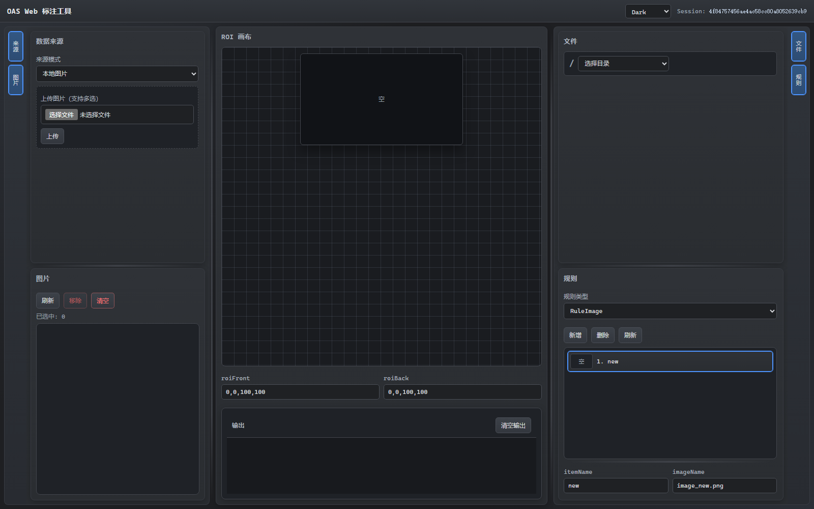

# OAS 日常维护与画面适配 SOP

适用仓库：`D:\3D\YYS2\OnmyojiAutoScript-easy-install-1`（分支 `port/xylolit-vendor`）
解释器：`.\toolkit\python.exe`（所有命令都在仓库根目录执行）

---

## 1. 每天 / 每次开机：一条命令体检

```powershell
cd D:\3D\YYS2\OnmyojiAutoScript-easy-install-1
.\toolkit\python.exe dev_tools\oas_maintain.py --hours 12
```

输出分 7 段，最后给 `PASS / WARN / FAIL` 结论（`FAIL` 时退出码 1）：

| 段 | 看什么 | 典型 FAIL |
| --- | --- | --- |
| 仓库 | 分支、AutoUpdate、未提交改动 | `AutoUpdate: true`（启动会 reset --hard 抹掉改动） |
| 模板 | 2587 张 png、引用缺失、0 字节坏图 | 「引用缺失（会加载）」> 0 |
| 实例 | 每个 `config/oas*.json` 的实时帧/日志是否在刷新 | 实时帧 > 90s 没动 = 实例已死 |
| 模拟器 | MuMuManager 实例状态、adb 在线设备、端口对齐 | adb 无在线设备 / 端口不在列表 |
| 画面 | OASX 叠加浮层、输入焦点 | 叠加浮层存在 / `mCurrentFocus=null` |
| 错误 | 最近 N 小时 ERROR 指纹 | 同一指纹反复出现 |
| 识图 | 用最新 live 帧跑页面模板，报告当前在哪一屏 | 0 命中且不是加载页 |

常用开关：

```powershell
.\toolkit\python.exe dev_tools\oas_maintain.py --skip-screen       # 跳过识图，快 3 秒
.\toolkit\python.exe dev_tools\oas_maintain.py --json-out log/maintain.json
.\toolkit\python.exe dev_tools\oas_maintain.py --fix-overlay       # 发现 OASX 叠加层就 am force-stop com.oas.oasx
```

---

## 2. 游戏更新后：画面适配 4 步

### 第 0 步（推荐先做）：开官方标注器，框选着改，而不是盲裁图

OAS 官方自带一套成熟的画面适配工具 —— **素材标注器**（`/tool/annotator`）。
平时它藏在 OAS WebUI 里（`http://127.0.0.1:<WebuiPort>/tool/annotator`），要先把整个 Web 服务开起来；
本仓库额外提供了**独立启动方式**，只跑标注器这一个页面，不启动调度器、不拉起实例：

```
双击仓库根目录的  启动素材标注器.bat
# 等价于
.\toolkit\python.exe dev_tools\annotator_standalone.py            # 默认 23333，自动开浏览器
.\toolkit\python.exe dev_tools\annotator_standalone.py --port 23456 --no-open
```

打开后能做的事（都不用手写 json）：

| 区域 | 能力 |
| --- | --- |
| 数据来源 | 「本地图片」上传截图（可多选）；「模拟器」模式直接抓 MuMu 实时帧 |
| ROI 画布 | 网格 + 拖框，实时显示 `roiFront` / `roiBack`；改框后立刻可测 |
| 规则 | 选任务 → 选 `image_*.json` → 列出规则（`itemName` / `imageName` / 阈值）→ 逐条测相似度 |
| 保存 | 写回 `image_*.json` 并**自动重新生成 `assets.py`**（不用手改生成物） |

要点：
- 用「模拟器」模式抓帧时**不要同时让 OAS 实例跑任务**（两个设备进程抢 nemu IPC 会成片截图超时）；
  OAS 在跑就用上传截图。
- 首次进入如果没有任务列表，确认是在仓库根启动（`tool.py` 用 `Path.cwd()` 当 PROJECT_ROOT）。
- 自检：`.\toolkit\python.exe dev_tools\annotator_standalone_check.py --port 23333`
  （建会话 → 传图 → 读规则 → 测模板 → 关会话，全 PASS 才算服务正常）。
- 完整一轮演练：`.\toolkit\python.exe dev_tools\annotator_adapt_drill.py --port 23333`
  （建 json → 裁模板 → 存规则 → 自动重生成 assets.py → 自动回滚）。改适配前先跑一遍，
  确认这条链路是通的，再动真规则。



### 第 1 步：拿到一帧「目标页面」的截图

优先用实例自己写的实时帧（不抢设备）：

```
log/live/oas1.jpg    log/live/oas3.jpg
```

需要特定页面时，用历史错误快照（`log/error/<ts>/*.png`，190+ 张，天然带「当时是什么页面」的上下文）。

### 第 2 步：全量扫一遍，看哪些模板塌了

```powershell
# 页面判定模板（82 项，判断当前停在哪一屏）
.\toolkit\python.exe dev_tools\asset_health_scan.py --screen log/live/oas1.jpg

# 全部 GameUi 模板（页面 + 功能 + 附加，递归扫 image_*.json）
.\toolkit\python.exe dev_tools\asset_health_scan.py --screen log/live/oas1.jpg --scope all --top 40

# 只列失配项
.\toolkit\python.exe dev_tools\asset_health_scan.py --screen log/live/oas1.jpg --only-fail
```

输出三段：汇总（命中/失配/最高分）→ **页面分组最高分**（当前界面）→ 明细（按分数升序，附 ROI 与中文说明）。

判定口径与 OAS 一致：模板图 + `roi_back` 搜索区域 + `TM_CCOEFF_NORMED` 最大值，`score >= threshold` 算命中。

### 第 3 步：裁出替换候选

```powershell
.\toolkit\python.exe dev_tools\asset_health_scan.py --screen log/live/oas1.jpg --recrop-out log/recrop
```

会把每个失配项按 `roiFront` 从当前帧裁成 `candidate_<原名>.png`，并写 `manifest.json`（含旧分、新 ROI、原文件路径）。
核对候选图确实是要的元素后覆盖对应模板，再跑一次第 2 步确认分数回到阈值以上。

> 注意：`tasks/<Task>/**/assets.py` 是 `dev_tools/assets_extract.py` 从同级 `image.json` 生成的。
> 换图不需要改代码；如果 ROI 也变了，要改 `image.json` 再重新生成，别手改 `assets.py`。

### 第 4 步：确认改动生效

- 任务模块（`tasks/<Task>/**`）每次运行都会重新加载 → 立即生效；
- `tasks/GameUi/*`、`module/**` 是普通 import → **必须重启实例**；
- 认准「真机帧匹配从不命中变命中」，不要只看代码 diff。

### 第 5 步（新活动）：从零建规则

新活动不是「改模板」而是「造规则」，顺序固定：

1. 建 `tasks/<NewAct>/`（`script_task.py` + 空 `assets.py`）；
2. 标注器「新建」`page_checks/image_<NewAct>.json` 当页面判定：一条 `image` 规则，
   `threshold` 取 0.85~0.9，`roiBack` 给目标周围留 20~40px 余量；
3. 再建交互规则：按钮用 `click`（只要 roiFront），要识别按钮亮/暗用 `image`，
   数字/文字用 `ocr`（`Single` + `keyword`；**不要**用 `Full` 做存在性判断）；
4. 每条规则都「测」到 similarity >= 阈值再保存（保存会重写 `assets.py`）；
5. 在 `script_task.py` 里用 `self.I_XXX` / `self.C_XXX` / `self.O_XXX`；
6. 配置注册后在仓库根跑
   `.\toolkit\python.exe -c "import sys;sys.path.insert(0,r'.');from module.config.config import Config;m=Config('oas1').model;print(len(m.script_task('Script')))"`
   确认配置页没被打崩，再 `py_compile`/`compileall`。

> 试错时千万注意：仓库有 `OAS-RepoAutosave` 每 20 分钟自动提交，演练产物要在提交前回滚
> （`dev_tools/annotator_adapt_drill.py` 自带回滚，手改的话 `git checkout -- tasks/<Task>/assets.py`
> 并删掉临时 json / png）。


---

## 3. 故障对照表（本项目实测过的）

| 症状 | 判断 | 处置 |
| --- | --- | --- |
| `Login failed more than 3` + `Too many click for a button: LOGIN_ENTER_GAME_ORIGIN` + 几十次 `Wait until appear LOGIN_LOGIN_SPECIFIC_SERVE timeout` | 点「进入游戏」后游戏要加载 ~33s，旧逻辑只等 5s 就重试，把一次加载打断成几十次点击 | 已修：`LoginHandler._wait_login_loaded()`（等 45s，同时接受角色页与庭院）；回归脚本 `dev_tools/login_loaded_wait_check.py` |
| `MinitouchOccupiedError` / `nemu_ipc screenshot() call timeout` 成片出现 | **同时跑了两个设备进程** | 先 `Get-CimInstance Win32_Process -Filter "Name='python.exe'"` 数进程；只留一个，别重复 `start_instance.py`（先跑体检确认实例已死） |
| `mCurrentFocus=null` 且点击全被吞 | OASX Mobile 的 `叠加视图 #1` 抢了焦点 | `.\toolkit\python.exe dev_tools\oas_maintain.py --fix-overlay`，或 `adb shell am force-stop com.oas.oasx`；长期共用模拟器可 `pm disable-user com.oas.oasx` |
| 实时帧几十秒不刷新 / 日志停在 `Script oasX process exit` | 实例退出（常因登录连续失败 3 次） | WMI 重拉：`Invoke-CimMethod -ClassName Win32_Process -MethodName Create -Arguments @{CommandLine='cmd.exe /c "cd /d <repo> && toolkit\python.exe dev_tools\start_instance.py oasX"'}`，40s 后确认帧在刷新 |
| `TimeoutError` 连续几次后 `RequestHumanTakeover` | nemu_ipc 抖动（`Device.screenshot()` 有 ADB 降级） | 先看 `dumpsys window` 游戏是否在前台；不在前台是 `GameNotRunningError`，交给 Restart |
| 网格/商店「识别不出」 | 空格子 vs 有卡认不出 | `dev_tools/shop_frame_scan.py --summary` 离线复现，先区分再调阈值 |

---

## 4. 工具清单（本次维护新增/改进）

| 工具 | 作用 | 验证 |
| --- | --- | --- |
| `启动素材标注器.bat` | 双击启动**独立标注器**（官方 `/tool/annotator`，不启动 OAS 调度） | 页面渲染 + 端到端自检全 PASS |
| `dev_tools/annotator_standalone.py` | 独立标注器服务：只挂 `/tool` 路由 + annotator 静态资源，独立端口 23333 | 69 任务、34 个 GameUi json 可读 |
| `dev_tools/annotator_standalone_check.py` | 标注器端到端回归（建会话→传图→读规则→测模板→关会话） | `check_demon_encounter` matched=True 0.976，回填 roiFront 27,657,42,43 |
| `dev_tools/oas_maintain.py` | 日常体检 7 段，一条命令给结论 | 实测跑通，2026-11-09 22:06 检出 oas1 实例死亡 + OASX 浮层 |
| `dev_tools/asset_health_scan.py` | 画面适配审计：全量模板打分、页面分组、失配裁候选 | 实测：错误快照命中 `check_demon_encounter` 0.976；自测裁图→1.000 |
| `dev_tools/asset_file_check.py` | 模板引用缺失检查（改为 AST 判引用方式） | 致命缺失 0，仅坐标用途 6 个（不再误报 temp/注释/异名声明） |
| `dev_tools/login_loaded_wait_check.py` | 登录等待逻辑离线回归 | `LOGIN LOADED WAIT CHECK: PASSED (failures=0)` |
| `dev_tools/patch_login_loaded_wait.py` | 登录等待补丁（幂等、自带编译校验） | 已应用，备份在 `log/login.py.bak_before_loaded_wait` |

> 官方标注器 vs 自研扫描器：标注器适合「知道哪条规则坏了、要改框改图」，
> `asset_health_scan.py` 适合「不知道哪条坏了，先全量筛一遍」。两者互补，不重复。

---

## 5. 已知待办

- [ ] 登录等待修复的**实机验证**：下次 `Restart`（每日 09:05）后统计 `Click ... @ LOGIN_ENTER_GAME_ORIGIN` 次数，
      应从 40+ 降到 1~2 次；日志里 `LOGIN_LOGIN_SPECIFIC_SERVE timeout` 应基本消失。
- [ ] `I_LOGIN_SPECIFIC_SERVE`（`login_login_specific_serve.png`，270x65）在 191 张历史截图里 0 命中（最高 0.382），
      若确认游戏已无「角色名横幅」形态，应改用 OCR 角色卡列表（需要 keyword，不能用 FULL+空 keyword）。
- [ ] `O_LOGIN_SPECIFIC_SERVE` 是 `OcrMode.FULL` + 空 keyword，在任何有文字的游戏画面上都为真（町中实测返回 `(793,316,21,19)`），
      不能当「角色页存在」判据。
- [ ] 6 个「仅坐标用途」的缺失模板（`fire_pass_8`、`invite_wq_friend_1..5`）：当前 `click()` 传参不加载图，
      一旦有人改成 `appear()` 就会炸，建议补图或改成 `RuleClick`。

## 6. 皮肤适配：先分清是哪一套（2026-11-10 教训）

口头叫法不可靠，一定先按配置项归类：

| 口头说法 | 配置项 | 枚举 | 影响界面 |
| --- | --- | --- | --- |
| 庭院皮肤 | costume_main_type | MainType | 庭院主页（探索/召唤/町中/宠物屋） |
| **结界皮肤** | costume_realm_type | RealmType | 阴阳寮 → 结界（式神育成 / 结界卡 / 结界防守 / 结界的皮肤=鸟居） |
| 鲤鱼旗 | costume_carpbanner_type | CarpBannerType | 结界界面里的鲤鱼旗 |
| 幕间 | costume_shikigami_type | ShikigamiType | 式神录 / 御魂页 |

判据：官方公告标题写的是「结界皮肤」还是「庭院皮肤」；和用户说法不一致就先问，不要直接改。

**新增结界皮肤**（本项目已补齐上游缺失的机制）：

`
.\toolkit\python.exe dev_tools\realm_add_skin.py --id 6 --image log/_realm_clear.png
.\toolkit\python.exe dev_tools\realm_register_skin.py --id 6 --name 神安眠处
# 再把 config/oasN.json 的 costume_realm_type 设成 costume_realm_6
`

上游原本只有 RealmType.COSTUME_REALM_DEFAULT 且没有 check_costume_realm，
所以选了结界皮肤不会生效；现在由 
ealm_register_skin.py 补上枚举、
ealm_costume_model
和 check_costume_realm，并在 check_costume() 里挂接（结界在鲤鱼旗之前应用）。

**新增庭院皮肤**仍是：costume_add_skin.py + costume_register_skin.py。
